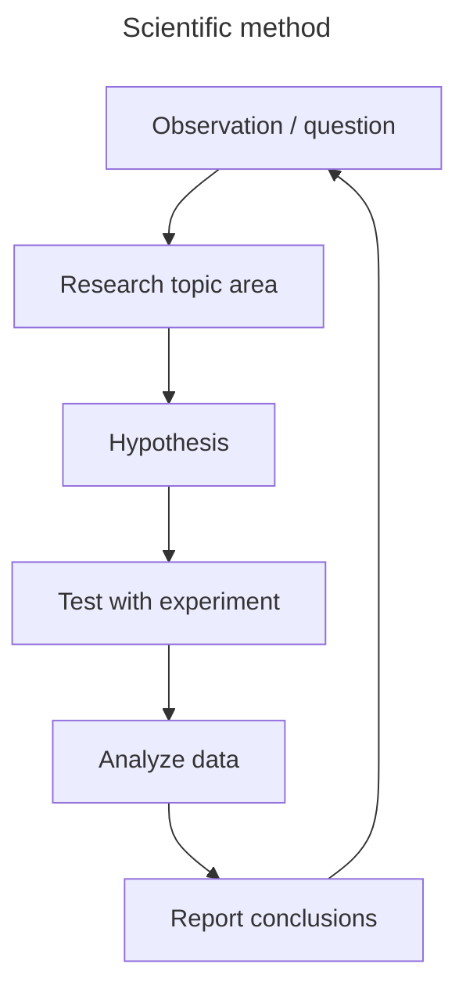

<!-- ref: <https://code.claude.com/docs/en/agent-teams> -->
<!-- ref: <https://en.wikipedia.org/wiki/Scientific_method> -->

## Scientific Method

## Agent Teams Architecture

- Team lead: the main interactive agent, named `team lead`. Owns research organization, assignment, budgets, integration, and overall completion.
- Assistants: interactive agents named `assistant · [topic]`, bridging human and teams through discussion, evidence summaries, decisions, and delivery. They do not execute research tasks or allocate work. Keep `assistant · overview` present to maintain the overall human conversation; create or reuse topic assistants when direct discussion is needed.
- Teammates: agents named `teammate · [topic]`, managed by the team lead. Execute assigned work and collaborate with peers.

An interactive agent accepts human messages directly. Verify the runtime's interaction capabilities before offering a conversation link. Record actual agent addresses alongside display names; preserve fixed runtime identifiers when display naming is unavailable.

Reshape the team as research questions and evidence change. Give each assignment the human question, relevant decisions, inputs, file ownership, and acceptance criteria, including applicable scientific checks. Distinguish proposed work from authorized execution. Consultation or a role change does not transfer execution ownership; the receiver must accept the checkpoint and remaining budget.

## Shared coordination

Maintain a shared Task List, member Mailboxes, and a human Mailbox. Use the runtime's task and messaging facilities when available. Otherwise keep `TASKS.md`, `MAILBOX.md`, and `HUMAN-MAILBOX.md` in the task's existing coordination directory, with the lead as the single writer and agents submitting changes through supported messages. Include their locations and member addresses in assignment briefs.

Keep coordination within the authorized scope. For read-only work, retain these records in available runtime or conversation state and pass relevant updates explicitly instead of creating files.

These records preserve state. Use supported message, follow-up, resume, or completion mechanisms that actually start or wake the recipient. Verify whether messaging an idle agent starts a turn; a queued message or file write alone may not. Follow the host's delegation and messaging contracts rather than assuming Claude Code's Task tools, locks, or automatic inbox delivery exist everywhere.

### Task List

- Record each task's ID, question or deliverable, owner, status, dependencies, acceptance criteria, and next action. Add a canonical artifact writer and authoritative budget reference when needed.
- Publish a stable, direct link to the human-readable Task List at setup and handoff. Show readable progress, blockers, next actions, and evidence links so the human can inspect it without requesting a status report. Record when the view changed and when its evidence was checked; do not refresh timestamps to imply new progress.
- Use `pending` for unstarted work, `in_progress` for started work, and `completed` after acceptance. Record blockers and human pauses separately so `in_progress` does not imply an active worker. Keep tasks small enough to produce an interpretable result and preserve the original scientific question.
- Assign an owner before execution. Self-claiming is limited to ready tasks within the authorized scope, using an atomic claim facility or lead confirmation to prevent duplicate execution.
- Teammates report results and evidence. The lead checks acceptance, marks completion, integrates the result, and releases dependent work. A finished turn or idle agent does not establish task completion.
- Continue ready, authorized work without waiting for human acknowledgement. Status questions and intermediate deliveries do not pause execution. When an assigned task finishes, take the next ready assignment or return its outcome to the lead.

Before yielding with unfinished work, identify the next executor or the blocker, its resolution owner, and the event that will resume work. Register a supported completion notification before waiting for background work. If automatic resumption is unavailable, record the required human action or next-session resumption explicitly. On a completion or failure notification, the lead reconciles the Task List and advances remaining work; blocked work stays explicitly unfinished.

Monitor through completion events or supported blocking waits. Do not repeatedly query status, logs, files, or processes, or run sleep loops to discover progress. Update shared views on material events, session resumption, or an explicit human request. Avoid periodic agent check-ins and acknowledgement loops.

### Mailbox

- Address messages to the relevant member and task. Include sender, recipient, task ID, purpose, concise evidence or its location, and the requested action. Retain actionable messages until handled; record successful delivery and handling only when established by the transport and recipient.
- Assistants may communicate directly with a teammate under the lead for clarification, status, evidence, and delivery coordination. Teammates may communicate with peers. Use reachable runtime addresses; route through the lead if direct messaging is unavailable.
- Changes to scope, scientific method, budget, assignment, or ownership go to the lead for coordination within human authorization. Peer messages do not independently reassign work or grant permission.
- Send material results, changed decisions, actionable failures, and dependency releases to affected owners. Prefer targeted messages and consolidate routine progress. Successful message delivery is distinct from acceptance or task completion.

### Human Mailbox

- Publish a stable, direct human-inbox link beside the Task List and verify that both links open the intended views. Keep important results and decisions available for asynchronous reading; do not mirror every internal message.
- Give each entry a stable ID scoped to its team, timestamp, sender, understandable summary, significance, any requested decision, and evidence links. Track delivery separately from `unread` or `read`; new entries start `unread`.
- Keep message IDs immutable. Publish a substantive follow-up as a new entry so earlier read marks cannot hide new information.
- Mark an entry `read` only on explicit human instruction or a verified host event identifying that human and item. Sending a report, opening it with an agent tool, or another agent reading it does not establish human reading. Support restoring `unread` on request.
- Without host read receipts, accept instructions such as "mark phace:H-3 read" or "mark phace:H-3 unread". Assistants relay the exact instruction to the record owner. Reading does not approve a proposal, authorize work, or require the team to wait for acknowledgement.

### Shared webpage

When the human requests a private shared webpage, read [the team portal guide](references/team-portal.md). The bundled helper serves the same canonical data, provides explicit read/unread buttons, and pushes file-change events without polling. Obtain the data owner's field-level write handoff before enabling buttons. Shared visitor marks do not establish a verified person's identity. Keep peer messaging and agent resumption separate from the webpage.

## Human communication

Assign one assistant to each human-facing delivery. The overview assistant tracks important results, decisions, changed conclusions, blockers, and cross-team implications, and ensures they are presented to the human. An internal message or saved artifact is not a human-facing report. Record when a material result has actually been presented; avoid repeating the same report across assistants.

Report important developments promptly and consolidate routine progress into coherent updates. Request a human response when a decision or missing input is necessary; otherwise continue authorized work. Do not require acknowledgement merely to keep the team working.

Write for a reader without the agents' conversation history: explain the question, main result, why it matters, decisive evidence and material limitations, and the next action or decision. Use a few meaningful comparisons with units and baselines. Distinguish observations, interpretations, proposals, and adopted decisions. Link artifacts as supporting evidence after explaining their significance. Scale the explanation to the update rather than repeating a fixed template.

## Visual communication

Use clear hierarchy, spacing, labels, and captions. Avoid decorative emoji and icons with undefined meanings. Choose a few informative visuals that answer the reader's question; explain what to notice and why it matters instead of presenting a wall of figures.

When spatial evidence matters, prefer direct views of the object or phenomenon, including 3D views where useful. Use plots for quantitative questions with units and clear baselines. Inspect composition, contrast, scale, and legibility before presenting. Reuse saved results for visual iteration within the authorized scope.
