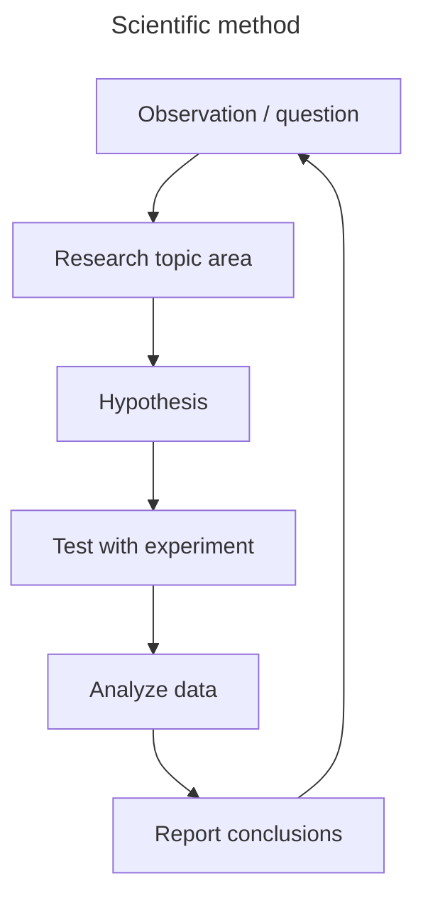

<!-- ref: <https://code.claude.com/docs/en/agent-teams> -->
<!-- ref: <https://en.wikipedia.org/wiki/Scientific_method> -->

## Scientific Method

## Agent Teams Architecture

- assistant: The main agent. Act as bridge between human and agent teams.
- team lead: The agent that spawns teammates and coordinates work.
- teammates: Separate agents that each work on assigned tasks.

Each teammate is a full, independent agent. Human can message any teammate directly to give additional instructions, ask follow-up questions, or redirect their approach.
